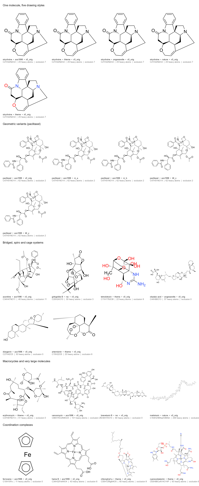

# OCSR-complex: A Held-Out Benchmark for Structurally Hard Optical Chemical Structure Recognition

**OCSR-complex** is a held-out evaluation benchmark designed to stress-test Optical Chemical Structure Recognition (OCSR / image-to-structure) systems far beyond the drug-like patent regime. Whereas contemporary OCSR models routinely report $>90\%$ exact-match accuracy on standard patent corpora (e.g., USPTO, Clef, UOB), their performance degrades sharply on stereochemically dense, topologically entangled, and multi-centre coordinated depictions that are ubiquitous in natural products, total synthesis, and organometallic literature.

To prevent training-set contamination and benchmark overfitting, **the evaluation image grid, sampling manifests, compound registry, and ground-truth annotations remain strictly private**. This public repository provides the benchmark methodology, the 11-model v2.0 evaluation leaderboard and diagnostic analysis (alongside longitudinal comparisons against v1.1), an illustrative sample gallery (`samples/`), and the complete inference and scoring harness (`tools/`).



*Figure 1: Illustrative examples of the rendering pipeline under `samples/`. These depictions demonstrate the journal stylesheets and geometric perturbations used in OCSR-complex; they are not part of the held-out evaluation set.*

---

## 1. Benchmark Design & v2.0 Evaluation Protocol

### 1.1 Targeted Structural Failure Modes
The benchmark deliberately over-samples five classes of 2D chemical depictions where visual perception and topological reconstruction are genuinely ambiguous:

1. **Bridged Polycyclic & Cage Architectures** — Systems containing bonds drawn *behind* a bridgehead or within high-strain polycyclic cages, inducing severe 2D bond-crossing occlusion (`has_bridged_ring`, `has_cage`).
2. **Quaternary Spiro Systems** — Molecules featuring one or more spiro-fused ring junctions where local bond-angle congestion complicates vertex degree assignment (`has_spiro`).
3. **Macrocycles & Large Biopolymers** — Large-ring macrolides, polyenes, cyclic peptides, and polyether ionophores where long-range ring-closure tracking and conformational degeneracy challenge sequence and graph decoders (`has_macrocycle`, `is_large`).
4. **Stereo-Dense Natural Products** — Scaffolds carrying dense arrays of wedge/hash bonds and configurated alkenes, testing fine-grained local visual discrimination coupled with global Cahn–Ingold–Prelog (CIP) / SMILES parity consistency (`is_stereo_dense`, `has_e_z`).
5. **Coordination & Organometallic Complexes** — A dedicated benchmark module (`coordination_benchmark/`) spanning $\eta^5/\eta^6$ sandwich metallocenes, metallated macrocyclic cavities (porphyrins, chlorins, phthalocyanines, corrins), and $\sigma$-bonded / chelated transition-metal complexes (`is_organometallic`).

### 1.2 Evolution from v1.1 to v2.0
Building upon the empirical findings and methodological audit of v1.1, **OCSR-complex v2.0** introduces four structural and statistical upgrades:

* **Substantially Expanded Organic Corpus & Dedicated Coordination Separation**: The organic evaluation corpus has been more than doubled in chemical diversity, while multi-centre coordination complexes are decoupled into an independent benchmark track (`coordination_benchmark/`) so that organometallic representation conventions never confound organic accuracy metrics.
* **Exhaustive Five-Variant `acs1996` Evaluation**: Full-grid multi-stylesheet experiments in v1.0/v1.1 established that publisher stylesheet variation shifts accuracy by only $\sim 0.8\text{--}3.7$ percentage points (standard deviation $2.2\text{--}3.2\%$ across seven journal templates), whereas sub-sampling template/pose pairs (`random_seed42`) introduces sampling variance. In v2.0, the canonical evaluation protocol tests **every compound across all five geometric pose variants** (`v0_orig`, in-plane rotations `rz_a`/`rz_b`, and out-of-plane perspective homography tilts `tilt_x`/`tilt_y`) under the standard American Chemical Society stylesheet (`acs1996`).
* **IUPAC-Informed Algorithmic Depiction Engine**: All structures are curated from [PubChem](https://pubchem.ncbi.nlm.nih.gov/) (cross-verified against [Wikidata](https://www.wikidata.org/)) and laid out through a multi-seed 2D/3D-projection search and repair pipeline aligned with IUPAC 2006/2008 graphical standards—preserving CIP stereocentres and configured $E/Z$ double bonds, resolving spiro-epoxide and terminal-label collisions, and rendering via **ChemDraw** without destructive auto-cleaning.
* **Denominator-Calibrated Stereochemical Metrics**: Rather than conflating achiral or alkene-free molecules with stereochemical matches or failures, v2.0 restricts tetrahedral (`Chiral %`) and double-bond (`E/Z %`) accuracy denominators strictly to compounds possessing assigned tetrahedral stereocentres or configurated $E/Z$ double bonds, respectively, alongside compound-weighted $E/Z$-blind chirality (`Chirality No-E/Z %`).

### 1.3 Scoring Metrics
* **Organic Headline (`Organic Exact %`)**: Computed at the compound level (mean accuracy across all five evaluated geometric variants per compound) using a stratified weighting scheme that down-weights compact baseline structures so that complex scaffolds govern the headline metric. A prediction is scored as `Exact` if and only if its RDKit canonical isomeric SMILES is identical to the ground truth.
* **Tetrahedral Chirality (`Chiral %`) & Double-Bond Geometry (`E/Z %`)**: Evaluated exclusively over compounds bearing assigned tetrahedral stereocentres (`Chiral %`) or configurated $E/Z$ alkenes (`E/Z %`).
* **Chirality-Kept Match (`Chirality No-E/Z %`)**: Evaluates canonical SMILES identity across all organic compounds after stripping double-bond $E/Z$ (`/` and `\`) directional markers while strictly retaining all tetrahedral (`@`/`@@`) stereocentres, isolating $E/Z$ convention penalties from tetrahedral inversion errors.
* **Tautomer Match (`Tautomer %`)**: Evaluates canonical-tautomer InChIKey equivalence via RDKit `TautomerEnumerator` on structures within the tractable heavy-atom enumeration bound, ensuring that valid prototropic tautomers (e.g., keto–enol or amide–imidol forms) are not penalized as topological errors.
* **Constitutional Connectivity (`Connectivity %`)**: Stereo-blind canonical SMILES identity (equivalent to matching the 14-character InChIKey skeleton block on organic structures), measuring pure 2D molecular graph topology recovery.
* **Structural Similarity (`ECFP4 Tanimoto %`)**: Compound-weighted mean Morgan fingerprint (radius 2, 2048 bits) Tanimoto similarity over all organic depictions (assigning $0.0$ to unparseable outputs), quantifying partial structural recovery on near-miss predictions.
* **Coordination Ligand-Skeleton Score (`Coordination Parts %`)**: Evaluated on the dedicated coordination module via a canonical **part key** (`coord_depict.py`) that verifies each metal centre, its non-haptic $\sigma$/chelate coordination sphere, and the charge-/radical-normalized canonical skeletons of all coordinated ligands.

---

## 2. Benchmark Results (11 Models)

### 2.1 v2.0 Organic Leaderboard & Longitudinal Comparison with v1.1
We evaluate 11 open-weights OCSR models spanning three primary architectural paradigms:
1. **1D Chemical Line-Notation Autoregressive Decoders** (**DECIMER**, **COMO**, **MolParser-Mobile-V2**, **OCSRGlyph**, **MolSight**, **MolSight-stereo**);
2. **2D Molecular Graph Reconstruction Hybrids** (**MolScribe**, **MolNexTR**, **MolGrapher**);
3. **Vision–Language Models (VLMs)** (**TinyChemVL**, **MarkushGlyph**).

| Model | Paradigm & Backbone | Org. Valid % | **v2.0 Organic Exact %** (95% CI) | v1.1 Exact % | **Connectivity %** (95% CI) | Chiral % | $E/Z$ % | Chirality (No-$E/Z$) % | Tautomer % | ECFP4 Tanimoto % | Pose SD % |
|---|---|---:|---:|---:|---:|---:|---:|---:|---:|---:|---:|
| **DECIMER** (v2.7.1) | EfficientNetV2 + Transformer $\to$ **SELFIES** | **95.4** | **59.1** (±3.4) | 58.6 | **78.4** (±2.8) | **61.2** | **66.1** | **62.1** | **64.3** | **90.5** | 0.64 |
| **MolScribe** | Swin-B + **Graph** Autoregressive Decoder | 74.0 | 45.1 (±3.3) | 41.1 | 63.5 (±3.2) | 50.9 | 39.0 | 51.6 | 52.1 | 70.3 | 1.33 |
| **MolNexTR** | ConvNeXt + ViT + **Graph/SMILES** Decoder | 76.0 | 44.0 (±3.2) | 41.1 | 59.4 (±3.1) | 49.0 | 35.3 | 49.5 | 49.0 | 69.7 | 0.62 |
| **COMO** (Tanimoto-RL) | Swin-B + 6L Decoder + Graph Stereo Postproc | 78.3 | 37.5 (±3.3) | 35.5 | 66.8 (±3.2) | 56.4 | 0.0 | 57.3 | 42.8 | 75.2 | **0.31** |
| **MolParser-Mobile-V2** | ViT-Tiny + 6L Decoder (10.0M) $\to$ **E-SMILES** | 80.1 | 25.6 (±2.8) | 27.9 | 43.9 (±3.2) | 26.7 | 26.3 | 27.7 | 29.8 | 66.9 | 0.71 |
| **OCSRGlyph** | Swin-B/384 + Transformer Decoder $\to$ **SMILES** | 77.1 | 19.2 (±2.5) | 18.0 | 49.3 (±3.3) | 21.0 | 19.8 | 23.5 | 22.7 | 68.4 | 0.59 |
| **MolSight** | EfficientViT-L1 + 6L Decoder (67.5M, Char+Edge) | 77.8 | 19.0 (±2.6) | 20.2 | 45.2 (±3.4) | 18.7 | 25.8 | 20.9 | 22.7 | 66.6 | 0.46 |
| **MolSight-stereo** | EfficientViT-L1 + 6L Decoder + Stereo-GRPO LoRA | 79.0 | 18.2 (±2.6) | 19.1 | 44.5 (±3.4) | 18.0 | 25.3 | 20.3 | 22.2 | 66.6 | 0.52 |
| **MolGrapher** | ResNet-18 Keypoints + **GCN** Classifier + OCR | 85.5 | 8.1 (±1.8) | 6.1 | 44.2 (±3.3) | 6.5 | 9.8 | 9.6 | 10.1 | 57.9 | 0.63 |
| **TinyChemVL** | InternViT-6B + Qwen2.5-3B (~9B VLM) $\to$ **SMILES** | 91.4 | 7.2 (±1.7) | 14.6 | 13.8 (±2.2) | 6.9 | 1.8 | 8.2 | 8.7 | 46.3 | 0.43 |
| **MarkushGlyph** | Qwen3.5-2B-Base + LoRA VLM $\to$ **CXSMILES** | 58.7 | 2.7 (±1.0) | 5.2 | 13.6 (±2.3) | 1.4 | 3.0 | 3.0 | 4.6 | 38.7 | 0.36 |

> **Statistical Resolution & Compact-Stratum Calibration:** Confidence intervals are computed via 10,000 paired compound-level bootstrap resamples. Out of all 55 pairwise model comparisons on v2.0 `Organic Exact %`, **50 pairs (90.9%) are statistically significant at $\alpha = 0.05$ after Holm step-down correction** (up from 45/55 in v1.1). Only five pairs remain statistically indistinguishable: **MolScribe** vs. **MolNexTR** ($\Delta = +1.1\%$, $p_{\text{Holm}} = 1.00$), the **OCSRGlyph** / **MolSight** / **MolSight-stereo** cluster ($\Delta \le 1.0\%$, $p_{\text{Holm}} = 1.00$), and **MolGrapher** vs. **TinyChemVL** on exact match ($\Delta = +0.9\%$, $p_{\text{Holm}} = 1.00$; though **MolGrapher** exceeds **TinyChemVL** by $+30.4$ points on connectivity). On the compact organic baseline stratum within v2.0, models achieve much higher exact accuracy (**DECIMER** 67.1%, **MolScribe** 58.8%, **MolParser-Mobile-V2** 54.1%, **COMO** 50.6%, **MolNexTR** 47.1%, **OCSRGlyph** 41.2%, **MolGrapher** 41.2%, **MolSight** 35.3%, **MolSight-stereo** 35.3%, **TinyChemVL** 32.9%, **MarkushGlyph** 22.4%), confirming that down-weighting simple structures is essential to prevent easy drug-like molecules from masking complex-scaffold failure modes.

---

### 2.2 Performance Across Structural Complexity Regimes (v2.0)
Table 2 reports compound-weighted accuracy across individual structural difficulty tags on the v2.0 organic corpus (`Exact % / Connectivity %`).

| Model | Bridged Rings | Spiro Centres | Macrocycles | Polycyclic Cages | Stereo-Dense | Large Molecules | Configured $E/Z$ | Bridged + Stereo-Dense |
|---|---:|---:|---:|---:|---:|---:|---:|---:|
| **DECIMER** | **44.7 / 69.2** | **50.4 / 74.6** | **43.1 / 67.2** | **25.8 / 55.7** | **55.0 / 76.2** | **42.1 / 64.2** | **46.9 / 73.8** | **39.2 / 67.5** |
| **MolScribe** | 29.2 / 46.9 | 29.9 / 50.1 | **25.3** / 53.4 | 17.5 / 28.3 | **40.5** / 59.6 | 27.0 / 45.3 | **30.4** / 58.7 | 23.6 / 43.0 |
| **MolNexTR** | **30.7** / 46.5 | **33.4** / 49.7 | 24.0 / 51.3 | **18.1 / 28.6** | 38.8 / 56.1 | **27.4** / 45.6 | 28.0 / 55.8 | **26.1 / 44.1** |
| **COMO** | 19.1 / **48.2** | 28.8 / **50.4** | 7.3 / **60.8** | 7.1 / **31.8** | 31.5 / **63.1** | 20.1 / **50.5** | 0.0 / **66.9** | 13.3 / 43.5 |
| **MolParser-Mobile-V2** | 14.0 / 30.2 | 14.7 / 34.6 | 13.8 / 26.6 | 4.7 / 10.6 | 18.1 / 37.3 | 5.4 / 11.5 | 15.3 / 32.0 | 8.5 / 24.8 |
| **OCSRGlyph** | 8.0 / 33.4 | 11.7 / 35.6 | 8.7 / 36.9 | 3.1 / 12.7 | 12.3 / 44.6 | 9.4 / 22.7 | 8.8 / 44.8 | 3.8 / 29.7 |
| **MolSight** | 9.0 / 29.2 | 8.5 / 31.3 | 7.4 / 35.2 | 1.8 / 6.6 | 12.1 / 39.3 | 7.8 / 19.2 | 11.5 / 38.2 | 5.2 / 24.5 |
| **MolSight-stereo** | 8.7 / 28.7 | 8.5 / 29.5 | 8.1 / 34.0 | 2.5 / 8.2 | 10.5 / 38.5 | 6.1 / 16.7 | 12.1 / 37.1 | 4.9 / 24.0 |
| **MolGrapher** | 4.5 / 30.8 | 6.2 / **35.7** | 1.4 / 32.1 | 1.0 / 17.0 | 4.0 / 38.6 | 1.7 / 14.3 | 1.8 / 36.2 | 1.3 / 27.0 |
| **TinyChemVL** | 3.9 / 6.7 | 2.9 / 7.1 | 0.0 / 2.2 | 0.9 / 1.1 | 4.1 / 8.7 | 0.6 / 1.7 | 0.2 / 5.3 | 1.2 / 4.1 |
| **MarkushGlyph** | 0.7 / 4.1 | 0.8 / 5.7 | 0.0 / 3.9 | 0.3 / 0.5 | 0.2 / 8.2 | 0.0 / 1.8 | 0.6 / 9.9 | 0.0 / 2.6 |

---

### 2.3 Error Taxonomy & Stereochemical Fidelity (v2.0)
To disentangle syntactic generation failures, topological graph errors, and stereochemical misassignments, Table 3 partitions $100\%$ of v2.0 organic image predictions into five mutually exclusive outcome categories, alongside conditional stereochemical precision ($\text{Exact} / \text{Connectivity}$ and its $E/Z$-blind counterpart), near-miss similarity on topologically incorrect but valid predictions, and median heavy-atom count deviation $|\Delta N_{\text{heavy}}|$.

| Model | Exact Match % | $E/Z$ Stereo Loss % | Tetrahedral / Both Stereo Loss % | Skeleton / Topo Error % | Unparseable / Invalid % | Conditional Stereo Precision % *(No-$E/Z$)* | Skeleton Error Mean Tanimoto % | Median $|\Delta N_{\text{heavy}}|$ (Skel. Err.) |
|---|---:|---:|---:|---:|---:|---:|---:|---:|
| **DECIMER** | **59.2** | 3.1 | 16.0 | 17.2 | **4.5** | **75.6** *(79.6)* | 70.0 | **1.0** |
| **MolScribe** | 45.3 | 6.4 | 11.7 | **10.6** | 26.0 | 71.5 *(81.6)* | 63.1 | **1.0** |
| **MolNexTR** | 44.0 | 5.5 | 9.7 | 16.8 | 24.0 | 74.4 *(83.6)* | 60.8 | **1.0** |
| **COMO** | 37.7 | 19.7 | **9.3** | 11.4 | 21.9 | 56.5 *(**86.0**)* | **73.1** | **1.0** |
| **MolParser-Mobile-V2** | 26.1 | 2.1 | 15.9 | 36.1 | 19.8 | 59.1 *(63.9)* | 63.6 | 2.0 |
| **OCSRGlyph** | 19.6 | 4.3 | 25.4 | 27.9 | 22.8 | 39.8 *(48.5)* | 68.4 | **1.0** |
| **MolSight** | 19.3 | 1.9 | 23.9 | 33.0 | 21.9 | 42.7 *(46.9)* | 65.1 | 2.0 |
| **MolSight-stereo** | 18.5 | 2.1 | 23.9 | 34.8 | 20.7 | 41.5 *(46.3)* | 63.7 | 2.0 |
| **MolGrapher** | 8.7 | 1.7 | 34.0 | 41.4 | 14.2 | 19.5 *(23.3)* | 33.0 | **1.0** |
| **TinyChemVL** | 7.6 | 1.1 | 5.6 | 77.2 | 8.5 | 53.2 *(60.9)* | 42.0 | 5.0 |
| **MarkushGlyph** | 3.0 | 0.4 | 10.6 | 45.0 | 41.0 | 21.5 *(24.7)* | 55.4 | 2.0 |

---

### 2.4 Coordination & Organometallic Recognition by Bonding Archetype
Table 4 reports performance (`Coordination Parts %` / `Valid %`) on the dedicated coordination and organometallic benchmark track across the three major bonding archetypes.

| Model | $\eta^5/\eta^6$ Sandwich Metallocenes | $\sigma$-Bonded / Chelate Complexes | Metallated Macrocyclic Cavities | Overall Coord. Parts % |
|---|---:|---:|---:|---:|
| **DECIMER** | **100.0** / 100.0 | 25.0 / 83.3 | 0.0 / 44.8 | **40.8** |
| **MolSight-stereo** | 91.7 / 7.1* | 25.0 / 91.7 | 0.0 / 9.4 | 37.7 |
| **OCSRGlyph** | 67.9 / 4.8* | **33.3** / **100.0** | 0.0 / 24.0 | 30.3 |
| **MolSight** | 64.3 / 7.1* | 22.2 / 94.4 | 0.0 / 12.5 | 27.2 |
| **MarkushGlyph** | 25.0 / 57.1 | **33.3** / 72.2 | 0.0 / 8.3 | 14.5 |
| **MolNexTR** | 10.7 / 7.1* | 16.7 / 69.4 | 0.0 / 24.0 | 6.6 |
| **COMO** | 7.1 / 7.1 | 16.7 / 66.7 | 0.0 / 7.3 | 5.3 |
| **MolParser-Mobile-V2** | 0.0 / 92.9 | 25.0 / 83.3 | 0.0 / 17.7 | 3.9 |
| **TinyChemVL** | 3.6 / 91.7 | 13.9 / 94.4 | 0.0 / 74.0 | 3.5 |
| **MolScribe** | 4.8 / 7.1* | 8.3 / 69.4 | 0.0 / 26.0 | 3.1 |
| **MolGrapher** | 0.0 / 100.0 | 0.0 / 97.2 | 0.0 / 42.7 | 0.0 |

*\*Note: Unsubstituted aromatic cyclopentadienyl rings (`c1cccc1`) emitted by SMILES decoders fail default RDKit Kekulé sanitization (`Valid %`), but are correctly parsed and verified by the coordination `parts` evaluator.*

---

## 3. Key Scientific Findings (v1.1 $\to$ v2.0 Synthesis)

1. **Invariance to Pose Perturbation vs. Vulnerability to Topological Entanglement.**  
   Across v1.1 (seven publisher stylesheets) and v2.0 (exhaustive five-pose evaluation per compound), typographic and geometric perturbations have minimal impact on recognition accuracy: in v2.0, the standard deviation across in-plane rotations (`rz_a`, `rz_b`) and out-of-plane perspective tilts (`tilt_x`, `tilt_y`) is $\le 0.71\%$ for 10 of the 11 models ($0.31\%$ for **COMO**, $0.46\%$ for **MolSight**, $0.62\%$ for **MolNexTR**, $0.64\%$ for **DECIMER**, and $1.33\%$ for **MolScribe**). By contrast, transitioning from compact organic scaffolds to polycyclic cages or macrocycles induces a $30\text{--}60$ percentage-point collapse across every architecture. Modern OCSR vision encoders are effectively pose- and font-invariant; **their fundamental bottleneck is chemical graph topology and stereochemical decoding**.

2. **Grammar-Free 1D Representation (SELFIES) Prevents Catastrophic Syntax Collapse on Large Scaffolds.**  
   **DECIMER** leads the v2.0 organic benchmark by a decisive margin ($59.1\%$ exact, $78.4\%$ connectivity, $64.3\%$ tautomer, $90.5\%$ compound-weighted ECFP4 Tanimoto). When the depiction pipeline was upgraded in v2.0 to resolve small-ring and spiro-epoxide congestion and use native 3D Schlegel/PCA projections for bridged cages, **DECIMER**'s connectivity recovery surged by $+7.4$ points over v1.1 ($71.0\% \to 78.4\%$), and its polycyclic cage accuracy nearly doubled ($14.3\% \to 25.8\%$ exact; $34.9\% \to 55.7\%$ connectivity). Whereas SMILES sequence decoders and 2D graph constructors suffer $19.8\text{--}41.0\%$ unparseable rates on complex natural products, **DECIMER**'s SELFIES representation guarantees $95.4\%$ syntactic validity, converting potential syntax crashes into high-similarity near-misses ($70.0\%$ mean Tanimoto on skeleton errors).

3. **2D Graph Reconstruction Hybrids Benefit Strongly from Depiction Repair and Lead on Skeleton Fidelity.**  
   Expanding the organic corpus and refining 2D bond-clearance geometry in v2.0 elevated both hybrid graph models—**MolScribe** ($41.1\% \to 45.1\%$ exact; $53.8\% \to 63.5\%$ connectivity) and **MolNexTR** ($41.1\% \to 44.0\%$ exact; $49.7\% \to 59.4\%$ connectivity)—with particularly large gains on large molecules ($\ge 60$ heavy atoms: $8.3\text{--}12.4\% \to 27.0\text{--}27.4\%$ exact) and macrocycles ($16.4\text{--}22.9\% \to 24.0\text{--}25.3\%$ exact). **MolScribe** achieves the lowest topological skeleton error rate of all 11 models ($10.6\%$), while **COMO** ($11.4\%$) and **MolNexTR** ($16.8\%$) follow closely. Conversely, purely bottom-up keypoint-and-GCN construction without sequence-level recovery (**MolGrapher**, $8.1\%$ exact, $44.2\%$ connectivity) remains vulnerable to bond crossings and large macrocycles: whenever a predicted graph disconnects into multiple fragments, **MolGrapher** falls back to a single-carbon sentinel (`C`) on $16.9\%$ of all v2.0 depictions ($24.3\%$ of cages and macrocycles, $39.9\%$ of large molecules, and $83.8\%$ of structures exceeding 100 heavy atoms).

4. **Denominator-Calibrated $E/Z$ and Tetrahedral Metrics Expose Post-Processing Trade-Offs.**  
   By evaluating `Chiral %` and `E/Z %` strictly on compounds carrying those respective stereochemical features, v2.0 cleanly separates tetrahedral parity recovery from alkene geometry:
   * **COMO**'s official post-processor transfers tetrahedral wedges/hashes from its auxiliary graph head while intentionally stripping alkene cis/trans markers (`ignore_cistrans=True`), yielding **$0.0\%$** on `E/Z %` and incurring a $19.7\%$ pure $E/Z$ stereo loss across all images. Yet on tetrahedral centres, **COMO** achieves **$56.4\%$ `Chiral %`** (second only to **DECIMER** at $61.2\%$, and ahead of **MolScribe** $50.9\%$ and **MolNexTR** $49.0\%$), jumping by $+19.8$ points under $E/Z$-blind evaluation ($37.5\% \to 57.3\%$) and reaching the **highest conditional no-$E/Z$ stereo precision ($86.0\%$)** and **highest skeleton-error Tanimoto similarity ($73.1\%$)** in the benchmark.
   * Among 1D SMILES decoders, **MolSight** ($25.8\%$ `E/Z %`) and **MolParser-Mobile-V2** ($26.3\%$ `E/Z %`) retain double-bond geometry substantially better than **OCSRGlyph** ($19.8\%$ `E/Z %`), whereas **OCSRGlyph** recovers more constitutional skeletons ($49.3\%$ vs. $45.2\%$ and $43.9\%$ connectivity).

5. **Scaling the Complex Corpus Exposes Severe Generalization Limits in VLMs and Narrow Post-Training.**  
   Longitudinal comparison from v1.1 to v2.0 reveals that while specialized OCSR architectures maintained or improved their accuracy on the expanded v2.0 corpus, general-purpose and Markush-specialized VLMs degraded by roughly half:
   * **TinyChemVL** ($\sim 9\text{B}$ VLM) dropped from $14.6\% \to 7.2\%$ exact and $24.1\% \to 13.8\%$ connectivity ($0.0\%$ exact on macrocycles and $0.2\%$ on configured $E/Z$ alkenes). Despite $91.4\%$ syntactic validity, $77.2\%$ of its outputs are topological hallucinations with a median heavy-atom count error of $|\Delta N_{\text{heavy}}| = 5.0$ atoms (vs. $1.0$ atom for **DECIMER**, **MolScribe**, **MolNexTR**, **COMO**, **OCSRGlyph**, and **MolGrapher**).
   * **MarkushGlyph** dropped from $5.2\% \to 2.7\%$ exact ($41.0\%$ unparseable, $45.0\%$ skeleton error), confirming that patent Markush CXSMILES fine-tuning induces severe catastrophic forgetting on complex natural product topologies.
   * **MolSight vs. MolSight-stereo**: Consistent with v1.1, GRPO LoRA post-training on synthetic stereoisomers slightly raises syntactic validity ($77.8\% \to 79.0\%$) and coordination metallocene accuracy ($27.2\% \to 37.7\%$), but reduces organic exact accuracy ($19.0\% \to 18.2\%$, $p_{\text{Holm}} = 1.00$) and stereo-dense scaffold recovery ($12.1\% \to 10.5\%$).

6. **Metallated Macrocyclic Cavities Remain an Unsolved Frontier in OCSR.**  
   On the dedicated coordination track, sequence models accurately parse $\eta^5/\eta^6$ sandwich metallocenes (**DECIMER** $100.0\%$, **MolSight-stereo** $91.7\%$, **OCSRGlyph** $67.9\%$, **MolSight** $64.3\%$) and partially recover $\sigma$-bonded/chelate transition-metal complexes (up to $33.3\%$). However, **all 11 models score $0.0\%$ on metallated macrocyclic cavities** (porphyrins, chlorins, phthalocyanines, corrins) due to dense central $M\text{--}N_4$ coordination bonds intersecting the conjugated macrocycle.

7. **Substantial Cross-Architecture Complementarity.**  
   On the v2.0 organic evaluation grid, the oracle union across all 11 models exactly solves **$73.8\%$** of all depictions ($73.8\%$ compound-weighted exact, $85.9\%$ image-level connectivity, and **$80.0\%$** of compounds solved in at least one geometric pose; **$88.8\%$** by connectivity)—surpassing the single best model (**DECIMER**, $59.1\%$) by $+14.7$ percentage points. Nine different models contribute uniquely solved exact predictions that all 10 competing models miss (**DECIMER**, **MolScribe**, **MolNexTR**, **COMO**, **MolSight**, **MolParser-Mobile-V2**, **OCSRGlyph**, **MarkushGlyph**, and **MolSight-stereo**), demonstrating strong complementarity between SELFIES sequence decoding, 2D graph reconstruction, and auxiliary graph-stereo post-processing.

---

## 4. Model Provenance & Evaluation Details

All models were evaluated deterministically (greedy decoding, beam size 1) using their official released checkpoints and post-processing pipelines:

* **DECIMER** (`v2.7.1`, [Kohulan/DECIMER-Image_Transformer](https://github.com/Kohulan/DECIMER-Image_Transformer), MIT): Standard TensorFlow SavedModel (`DECIMER.predict_SMILES`), decoding predicted SELFIES tokens into canonical SMILES.
* **MolScribe** ([yujieq/MolScribe](https://huggingface.co/yujieq/MolScribe), MIT): Checkpoint `swin_base_char_aux_1m680k.pth`, scored on its official graph-to-SMILES output.
* **MolNexTR** ([CYF200127/MolNexTR](https://huggingface.co/datasets/CYF200127/MolNexTR), Apache 2.0): Checkpoint `molnextr_best.pth`, scored on its official graph-to-SMILES output.
* **COMO** ([Keylab/COMO](https://huggingface.co/Keylab/COMO), CC BY-NC 4.0): Tanimoto-reward checkpoint `models/tanimoto/best.pth`. Scored on its official `postprocess` SMILES (which transfers tetrahedral stereocentres from the predicted graph and canonicalizes with cis/trans markers ignored, falling back to `decode_smiles` when graph stereo restoration fails).
* **MolParser-Mobile-V2** ([UniParser/MolParser-Mobile-V2](https://huggingface.co/UniParser/MolParser-Mobile-V2), CC BY-NC-SA 4.0): 10.00M-parameter checkpoint run in FP16 with `max_length=384`. Scored on the SMILES trunk preceding any E-SMILES `<sep>` or `|` suffix.
* **OCSRGlyph** (`EdisonScientific/glyph`): Swin-B/384 + Transformer decoder evaluated with default post-processing enabled.
* **MolSight & MolSight-stereo** ([hustvl/MolSight](https://github.com/hustvl/MolSight), [Robert-zwr/MolSight](https://huggingface.co/Robert-zwr/MolSight)): Evaluated on `pubchem_uspto_smiles_edges_10.pth` (`--formats char,edges`) and the Stereo-200k GRPO LoRA checkpoint `stereo_grpo_10_2.pth` (`--lora --formats char`), with upstream functional-group expansion (`_postprocess_smiles`) applied prior to scoring.
* **MolGrapher** ([DS4SD/MolGrapher](https://github.com/DS4SD/MolGrapher), MIT): Evaluated with the `gc_stereo_model` node classifier and `--assign-stereo`, patched via `tools/setup_molgrapher_wsl.py` to run unmodified checkpoints on modern PyTorch/CUDA (`torch 2.11+cu128`) with CPU PaddleOCR caption/label recognition.
* **TinyChemVL** (`InternViT-6B + Qwen2.5-3B`): Evaluated in BF16 with `<image>` token splicing and in-place `num_image_token` mutation patched per batch (`tools/predict_tinychemvl.py`).
* **MarkushGlyph** ([EdisonScientific/MarkushGlyph](https://huggingface.co/EdisonScientific/MarkushGlyph), Apache 2.0): LoRA adapter on `Qwen/Qwen3.5-2B-Base` prompted with `OCSR_NO_EXTENSION_PROMPT`; scored on the CXSMILES core preceding any `|` extension.

---

## 5. Repository Structure & Tooling

```text
.
├── samples/
│   ├── gallery.png                 # Contact sheet of illustrative depictions
│   ├── ground_truth.csv            # Isomeric SMILES, InChI, and structural descriptors for samples/
│   └── <image_id>.png              # Individual sample images (not part of the held-out evaluation set)
└── tools/
    ├── eval_ocsr.py                # Primary v2.0 scoring harness (Exact, Chiral, E/Z, Tautomer, Connectivity, Parts)
    ├── eval_extra.py               # Extended error taxonomy, Chirality-Kept (No-E/Z), and ECFP4 Tanimoto evaluator
    ├── stats_ci.py                 # Compound-level paired bootstrap 95% CIs and Holm-adjusted significance tests
    ├── compare_models.py           # Side-by-side multi-model comparison and agreement analyzer
    ├── make_random_split.py        # Stratified, seeded evaluation slice generator (v1.1 protocol)
    ├── predict_decimer.py          # Resumable inference driver for DECIMER 2.7.1
    ├── predict_molscribe.py        # Resumable inference driver for MolScribe
    ├── predict_molnextr.py         # Resumable inference driver for MolNexTR
    ├── predict_como.py             # Resumable inference driver for COMO
    ├── predict_molparser.py        # Resumable inference driver for MolParser-Mobile-V2
    ├── predict_ocsrglyph.py        # Resumable inference driver for OCSRGlyph
    ├── predict_molsight.py         # Resumable inference driver for MolSight & MolSight-stereo
    ├── predict_molgrapher.py       # Resumable/shardable inference driver for MolGrapher
    ├── setup_molgrapher_wsl.py     # Compatibility patcher for MolGrapher on modern PyTorch/CUDA
    ├── predict_tinychemvl.py       # Resumable inference driver for TinyChemVL
    └── predict_markushglyph.py     # Resumable inference driver for MarkushGlyph
```

### Running Inference & Scoring
All `predict_*.py` drivers accept a benchmark manifest (`--manifest`), an images root (`--images-root`), and an optional template filter (`--template acs1996`), writing resumable JSONL predictions (`{"image_id": "<id>", "prediction": "<SMILES>"}`):

```bash
# Score an ACS 1996 prediction JSONL file under the v2.0 protocol
python tools/eval_ocsr.py \
    --manifest path/to/manifest_all.jsonl \
    --predictions predictions/v2_acs1996/decimer.jsonl \
    --template acs1996 \
    --out results/v2_acs1996_decimer

# Generate a side-by-side multi-model comparison report
python tools/compare_models.py \
    --manifest path/to/manifest_all.jsonl \
    --template acs1996 \
    --preds decimer=predictions/v2_acs1996/decimer.jsonl,molscribe=predictions/v2_acs1996/molscribe.jsonl,molnextr=predictions/v2_acs1996/molnextr.jsonl \
    --out results/comparison_v2_acs1996.md
```

---

## 6. Methodological Notes & Limitations

* **Separation of Coordination Complexes**: Because haptic and dative organometallic bonding cannot be canonically represented by a single SMILES string and is poorly normalized by standard InChI, coordination complexes are maintained in a dedicated benchmark track and evaluated via the structural `parts` key rather than mixed into the organic headline.
* **Protocol Comparability Across Versions**: v1.1 evaluated a multi-template random slice (`random_seed42`), whereas v2.0 evaluates all five geometric variants under `acs1996` across an expanded organic corpus with denominator-calibrated stereochemical metrics. Longitudinal comparisons between v1.1 and v2.0 therefore reflect both the expanded chemical difficulty of the v2.0 corpus and the refined depiction/evaluation protocol.
* **Exclusion of Homologue Mixtures**: Database records deposited as multi-component mixtures of homologues are excluded from the benchmark in favor of well-defined single-component entities.
* **Algorithmic Depiction Provenance**: All depictions are generated algorithmically from validated chemical graphs and styled/rasterized in ChemDraw rather than cropped from copyrighted journal PDFs. This guarantees ground-truth label fidelity while isolating chemical structure recognition from document-level figure segmentation.
* **Licensing**: All benchmark code, evaluation scripts, and sample files in this repository are released under the [MIT License](LICENSE). ChemDraw is commercial software of Revvity Signals. Ground-truth molecular records are derived from [PubChem](https://pubchem.ncbi.nlm.nih.gov/) (NCBI) and cross-checked against [Wikidata](https://www.wikidata.org/).
